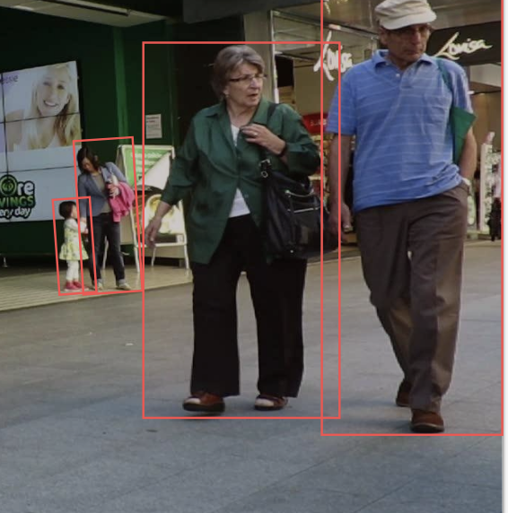
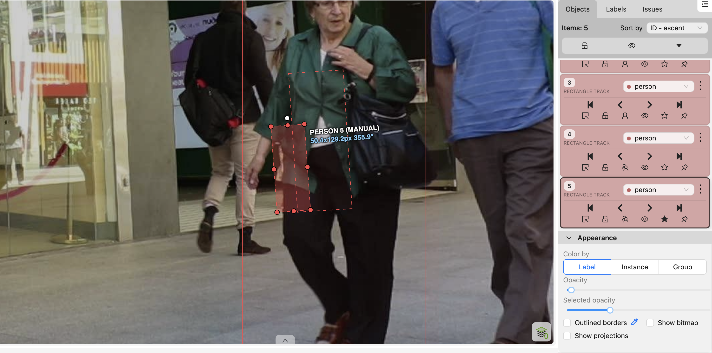
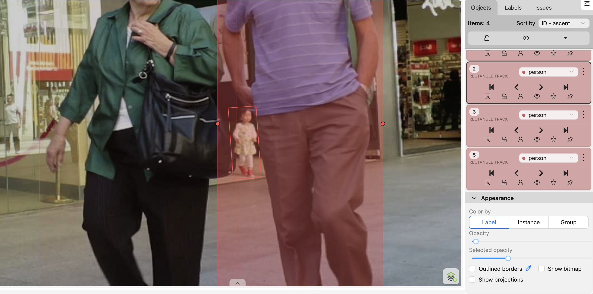

# Báo cáo cá nhân — VoTienPhat-2A202603130

Đoạn video: MOT17-09, 150 frame (frame 1–150), nguồn MOTChallenge, giấy phép CC BY-NC-SA 3.0.

## 0. Thông tin học viên

- Họ tên: Võ Tiến Phát
- MSSV: 2A202603130
- Mã đề (A/B/C): B
- Email: phat.votien03@gmail.com
- Link repository: https://github.com/phattiendo/K5-L2-DAY05-VoTienPhat-2A202603130-MOTTracking
- Giờ bắt đầu: 16:45 (13/11/2026)
- Giờ kết thúc: 19:05 (13/11/2026)

## 1. Xem trước đoạn video (CP0)

Ghi **trước khi vẽ**, mỗi người một dòng.

| Mã | Frame xuất hiện | Frame cuối thấy được | Rẽ / dừng / đổi tốc độ ở frame | Bị che ở frame | Ghi chú |
|---|---|---|---|---|---|
| P1 | 0 | 148 | 40, 110, 140 | 110–139 | Bé gái nhỏ mặc váy sáng màu đi phía sau, bị che khuất hoàn toàn bởi hai người lớn đi phía trước rồi lộ ra ở khe giữa |
| P2 | 0 | 149 | 30, 70, 110 | Không | Người phụ nữ mặc áo khoác xanh đậm, đeo túi đen lớn, tiến lại gần camera nên kích thước box tăng dần |
| P3 | 0 | 149 | 60, 68–70, 102 | 60–127 (một phần) | Người đàn ông mặc áo polo xanh sọc, đội mũ trắng đi bên phải, bị mép khung hình che một phần khi tiến sát camera |
| P4 | 0 | 149 | 40–55, 85, 115 | 42–44 | Người phụ nữ mặc áo xám cầm áo hồng đi bên cạnh P1, bị che khuất thoáng qua sau người phụ nữ áo xanh |
| P5 | 0 | 113 | 30, 50, 100 | 95–113 (một phần) | Đi dọc hành lang bên trái/giữa và rời khỏi vùng quan sát trước khi kết thúc clip |

## 2. Keyframe và thời gian (CP1, CP4)

Số keyframe lấy từ kết quả `src/check_submission.py`.

| Mã | Số keyframe | Keyframe ở frame | Số frame có mặt | Keyframe / 100 frame | Thời gian (phút) | Chỗ khó |
|---|---|---|---|---|---|---|
| P1 (Track 4) | 7 | 0, 10, 20, 30, 40, 110, 140 | 120 | 5.8 | 12 | Đối tượng nhỏ, bị che khuất hoàn toàn 29 frame sau hai người đi trước rồi xuất hiện lại ở khe hẹp |
| P2 (Track 0) | 16 | 0, 10, 20, 30, 40, 50, 60, 70, 80, 90, 100, 110, 120, 130, 140, 149 | 150 | 10.7 | 10 | Tiến thẳng về phía camera làm kích thước bounding box thay đổi liên tục |
| P3 (Track 1) | 17 | 0, 20, 30, 40, 50, 60, 68, 69, 70, 82, 92, 102, 112, 122, 132, 142, 149 | 150 | 11.3 | 11 | Sát mép phải khung hình (68 frame bị che một phần), cần ước lượng amodal box ổn định |
| P4 (Track 2) | 21 | 0, 10, 20, 30, 40, 45, 47, 49, 51, 53, 55, 65, 75, 85, 95, 105, 115, 125, 135, 145, 149 | 147 | 14.3 | 12 | Bị che khuất nhanh qua sau P2 (frame 42–44), phải đặt keyframe dày quanh mốc vào/ra vùng che |
| P5 (Track 3) | 7 | 0, 10, 20, 30, 40, 50, 100 | 114 | 6.1 | 9 | Xác định đúng frame cuối cùng rời khung hình (frame 113) để bật cờ `outside` |
| **Tổng** | **68** | — | **681** | **10.0** | **54** | — |

Keyframe / 100 frame của cả bài = tổng keyframe ÷ tổng số frame có mặt × 100 = `68 ÷ 681 × 100 = 10.0`

Bạn đặt keyframe nhiều nhất ở người nào? Vì sao (người đó rẽ, dừng, lại gần camera hay bị che)?

Đặt keyframe nhiều nhất ở **P4 (Track 2 — 21 keyframe)** và **P3 (Track 1 — 17 keyframe)**. Nguyên nhân là P4 di chuyển qua vùng bị che khuất phía sau P2 ở đoạn frame 40–55 nên cần đặt keyframe dày (cách nhau 2–5 frame) ngay trước lúc bị che và ngay sau lúc ló diện để nội suy tuyến tính không bị trôi lệch khỏi người; còn P3 vừa tiến lại gần camera vừa đi sát mép phải khung hình khiến kích thước và phần cơ thể bị cắt thay đổi liên tục.

## 3. Đoạn bị che (CP2)

Người bị che: `P1`

| Mốc | Frame |
|---|---:|
| Bắt đầu bị che một phần (bật `occluded`) | 110 |
| Mất hẳn (bật `outside`) | 111 |
| Hiện lại (tắt `outside`) | 140 |
| Thấy rõ trở lại (tắt `occluded`) | 141 |

- Thời gian khuất hẳn: `29` frame (từ frame 111 đến 139) = `0.97` giây.
- Quyết định: **Giữ cùng ID** (Track 4 / MOT ID 5).
- Lý do (trả lời 3 câu: khuất bao lâu so với 60 frame, ngoại hình có khớp, chỗ hiện lại có đúng hướng và tốc độ):
  1. **Thời gian khuất:** Bé gái khuất hẳn 29 frame (~0,97 giây), nhỏ hơn nhiều so với ngưỡng quy định 60 frame (2 giây) của lớp.
  2. **Ngoại hình:** Khi ló diện trở lại ở frame 140 qua khe giữa hai người lớn, trang phục (váy hoa sáng màu, quần legging trắng, giày đỏ) và vóc dáng nhỏ bé trùng khớp hoàn toàn với đối tượng trước khi bị che.
  3. **Hướng đi và tốc độ:** Vị trí xuất hiện lại nằm đúng trên quỹ đạo di chuyển thẳng tiến về phía trước với vận tốc đồng nhất so với đoạn frame 0–110.

Ảnh chụp màn hình (Nguồn ảnh: MOT17, MOTChallenge (Milan et al., 2016)):





## 4. Tự review ID (CP3)

Lượt 1 theo người (đi ngược từ frame 149 về 0 trên CVAT), lượt 2 theo cảnh (nhảy 10 frame). Ít nhất 3 dòng; không có lỗi thì ghi một dòng "đã kiểm hai lượt, không lỗi".

Loại lỗi dùng đúng một trong 7 mã: `id_switch`, `fragmentation`, `lost`, `merge`, `false_track`, `drift`, `flag`.

| Frame | Mã người | Loại lỗi | Mô tả một câu | Phát hiện ở lượt | Đã sửa? |
|---:|---|---|---|---|---|
| 110 | P1 | `flag` | Box ước lượng toàn thân bị thu nhỏ theo phần thân thò ra thay vì giữ nguyên amodal box khi bật `occluded`. | Lượt 1 | Có |
| 45 | P4 | `drift` | Box nội suy bị trôi lệch sang trái khi P4 vừa bước ra khỏi vùng che sau lưng P2. | Lượt 1 | Có |
| 140 | P1 | `lost` | Chưa tắt cờ `outside` kịp thời ở frame đầu tiên bé gái lộ diện giữa hai người lớn khiến bị thiếu 1 frame nhãn. | Lượt 2 | Có |

Tổng hợp số lỗi theo loại:

| `id_switch` | `fragmentation` | `lost` | `merge` | `false_track` | `drift` | `flag` |
|---:|---:|---:|---:|---:|---:|---:|
| 0 | 0 | 1 | 0 | 0 | 1 | 1 |

Lỗi nào chỉ lượt 2 (theo cảnh) mới thấy, lượt 1 (theo người) không thấy? Vì sao?

Các lỗi mang tính tương quan giữa nhiều đối tượng trên cùng một khung hình như **`merge`** (một box bao trùm nhầm cả hai người đi sát nhau), **`id_switch`** (hai track tráo đổi nhãn cho nhau khi giao cắt) hoặc **`lost` / `false_track`** cục bộ dễ được phát hiện ở **Lượt 2 (theo cảnh)** hơn. Vì ở Lượt 1 mắt chỉ tập trung bám theo quỹ đạo chuyển động liên tục của một cá nhân nên dễ bị "quen mắt" nếu nhãn trượt mượt sang người đi cạnh, trong khi Lượt 2 nhìn bao quát toàn bộ 5 box cùng lúc giúp nhận ra ngay sự bất thường về số lượng box hoặc nhãn bị gán chồng chéo.

## 5. File xuất và kết quả tự kiểm (CP4)

| Kiểm tra | Kết quả |
|---|---|
| Tên file MOT 1.1 | `src/exports/VoTienPhat_mot.zip` |
| Tên file CVAT for video 1.1 | `src/exports/VoTienPhat_cvat_video.zip` |
| Số track ID khác nhau trong `gt/gt.txt` (phải là 5) | `5` |
| Frame `outside` không có dòng trong `gt.txt` (đúng / sai) | `Đúng` |
| Job đã completed trên CVAT máy cá nhân | `Đã chuyển sang completed` |

Dán phần tóm tắt in ra từ `src/check_submission.py`:

```text
Số frame in theo CVAT (bắt đầu từ 0). Trong gt.txt, frame_id = frame CVAT + 1.

=== File MOT 1.1: VoTienPhat_mot.zip ===
  Số track ID: 5   |   Tổng số box: 681
  [OK]        Đúng 5 track ID.

  Track | Frame có mặt | Số frame | Đoạn vắng (outside)
      1 |   0–149      |      150 | -
      2 |   0–149      |      150 | -
      3 |   0–149      |      147 | 42–44
      4 |   0–113      |      114 | -
      5 |   0–148      |      120 | 111–139


=== File CVAT for video 1.1: VoTienPhat_cvat_video.zip ===

  Track | Nhãn   | Frame thấy | Keyframe | KF/100 frame | Frame occluded | Lần bật outside
      0 | person |        150 |       16 |         10.7 |              0 |               0
              Track 0: keyframe ở frame [0, 10, 20, 30, 40, 50, 60, 70, 80, 90, 100, 110, 120, 130, 140, 149]
      1 | person |        150 |       17 |         11.3 |             68 |               0
              Track 1: keyframe ở frame [0, 20, 30, 40, 50, 60, 68, 69, 70, 82, 92, 102, 112, 122, 132, 142, 149]
      2 | person |        147 |       21 |         14.3 |             52 |               1
              Track 2: keyframe ở frame [0, 10, 20, 30, 40, 45, 47, 49, 51, 53, 55, 65, 75, 85, 95, 105, 115, 125, 135, 145, 149]
      3 | person |        114 |        7 |          6.1 |             14 |               1
              Track 3: keyframe ở frame [0, 10, 20, 30, 40, 50, 100]
      4 | person |        120 |        7 |          5.8 |              1 |               2
              Track 4: keyframe ở frame [0, 10, 20, 30, 40, 110, 140]

  Tổng: 68 keyframe / 681 frame có mặt = 10.0 keyframe / 100 frame
  [OK]        Đọc được 5 track từ annotations.xml.

=== Tóm tắt ===
  Lỗi: 0   |   Cảnh báo: 0
  Đạt. Dán phần tóm tắt này vào báo cáo mục 5.